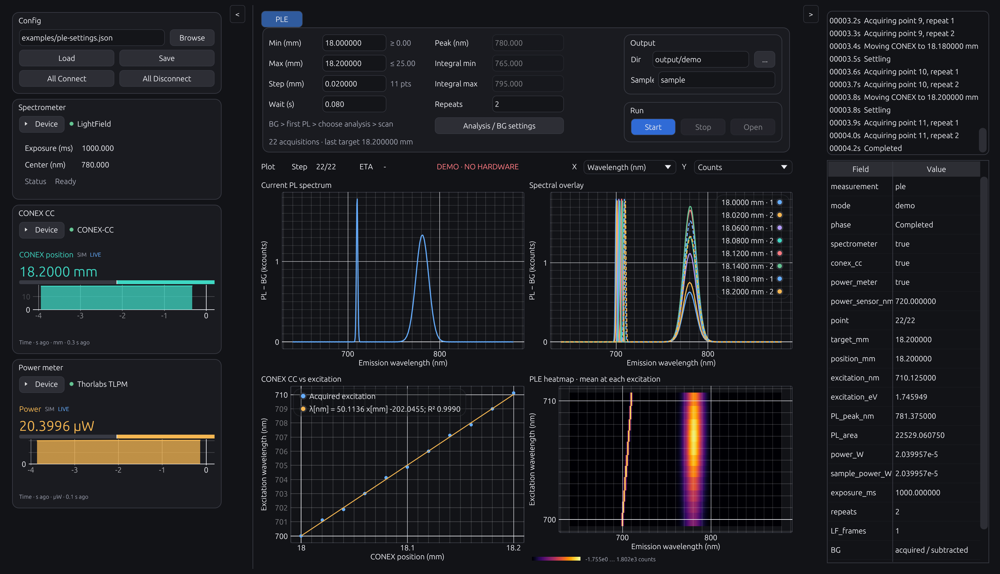

# KohdaLab PLE

[](https://github.com/woolen-yarn/kohdalab-ple/actions/workflows/test.yml)
[](LICENSE)

Rust desktop application for photoluminescence excitation measurements using LightField, remote CONEX CC motion, and power monitoring.

LightField・リモートCONEX CC・パワーメーターを組み合わせた、Rust製PLE測定アプリです。

[Download / ダウンロード](https://github.com/woolen-yarn/kohdalab-ple/releases) · [Documentation / 文書](docs/README.md) · [Report an issue / 問題の報告](https://github.com/woolen-yarn/kohdalab-ple/issues)

- BG → first PL → peak/integration selection → scan. / BG取得・最初のPL確認・解析区間選択・走査の順に進行。
- Live device traces, spectra, overlays, wavelength calibration and Inferno heatmap. / 機器ライブ表示・スペクトル・代表曲線・波長回帰・ヒートマップ。
- Rust measurement/analysis/storage engine, with an optional Python/Jupyter GUI client. / 測定・解析・保存はRust、Python/Jupyterからの外部操作にも対応。

## Interface / 画面



Synthetic data; no instruments connected. The layout and live monitors follow KohdaLab TRKR/IV. / 模擬データの画面です。実機は接続していません。配置・ライブモニターはTRKR／IVと統一しています。

## Downloads / ダウンロード

| Channel / 配布区分 | Packages / パッケージ | Qualification / 確認範囲 |
| --- | --- | --- |
| Prerelease / 実機確認用 | [GitHub Releases](https://github.com/woolen-yarn/kohdalab-ple/releases): Windows x64 portable ZIP, macOS Apple silicon app ZIP, source and checksums | [Validation record / 検証記録](docs/validation/README.md) |

Rust is not required for packaged applications. Hardware acquisition needs Windows, 64-bit Python and manufacturer software; Demo uses no devices. Windows packages are unsigned. macOS uses ad hoc signing and is not notarized.

配布版の起動にRustは不要です。実機取得にはWindows・64-bit Python・メーカーソフトが必要です。Demoは機器不要です。Windows版は未署名、macOS版はアドホック署名でApple公証は受けていません。実機確認用であり、実機検証済みの安定版ではありません。

## Supported hardware and SDK downloads / 対応機器・SDK入手先

| Role / 役割 | Backend / 利用方式 | Official download / 公式入手先 |
| --- | --- | --- |
| Spectrometer / 分光器 | LightField Automation SDK | [LightField software & firmware](https://www.teledynevisionsolutions.com/products/lightfield/) — sign-in may be required / ログインが必要な場合あり |
| CONEX CC | Controller-PC server; 0–25 mm / 制御PCのサーバー経由 | [Newport CONEX-CC software](https://www.newport.com/f/trb-actuator-conex-kits) — Resources → Software |
| Power meter / パワーメーター | Legacy TLPM .NET helper / 元zipのTLPM系ラッパー | [Thorlabs power-meter software](https://www.thorlabs.com/software_pages/ViewSoftwarePage.cfm?Code=PM100x) / [OPM](https://www.thorlabs.com/software_pages/ViewSoftwarePage.cfm?Code=OPM) |
| Optional BG shutter / 任意のBGシャッター | Thorlabs MFF via pylablib | [Thorlabs motion software](https://www.thorlabs.com/software_pages/ViewSoftwarePage.cfm?Code=Motion_Control) |

[SDK installation and version compatibility / SDKの導入・版の互換性](docs/guides/install.md) · [Hardware and transport / 機器と通信](docs/reference/hardware.md). Manufacturer DLLs are not bundled. / メーカーDLLは同梱しません。

Lab profile / 使用予定: **3900S · SpectraPro HRS-300 · PM100USB or PM100D**. CONEX defaults / 既定: **X=COM3, Y=COM4**. [Setup and active-axis details / 構成と走査軸](docs/reference/hardware.md#laboratory-setup--使用予定の構成).

## Quick start / はじめに

1. Extract the whole portable package. / portable版をフォルダーごと展開します。
2. Explore Demo before connecting instruments. / 最初はDemoで画面と測定手順を確認します。
3. Install the required SDKs, load a reviewed profile, then connect explicitly. / 必要なSDKを導入し、確認済み設定を読み込んで明示的に接続します。
4. Acquire BG and the first PL, choose peak/integration bounds, then continue. / BG・最初のPLを取得してピークと積分区間を決め、Continueで測定します。

[Full user guide / 詳しい操作](docs/guides/user-guide.md) · [Physical qualification / 実機確認](docs/guides/hardware-qualification.md) · [Python client / Pythonクライアント](bindings/python/README.md)

## Development / 開発

Cargo commands run from the repository root. / Cargoはリポジトリのルートで実行します。

```sh
cargo test --workspace --locked
cargo build --release --locked
cargo run --locked --bin kohdalab-ple
python -m unittest discover -s tests -v
python scripts/check_docs.py
```

```text
crates/       Rust desktop application and measurement core / GUI・測定・解析・保存
bindings/     Optional Python/Jupyter client / 外部操作クライアント
bridge/       LightField/Thorlabs SDK adapters / ベンダーSDKとの接続
servers/      Remote controller services / リモート機器サーバー
examples/     Reviewed profile templates / 設定例
scripts/      Build, package and validation entry points / ビルド・配布・検証
tests/        Device-free checks / 実機を使わない検証
docs/         Guides, development, reference, validation and images / 操作・設計・仕様・検証・画像
```

The future supplied CONEX CC server belongs in [servers/conex-cc/](servers/conex-cc/README.md). Its program has not been supplied yet; the existing reference adapter remains available. / 後日いただくCONEX CCサーバーの受け入れ先は `servers/conex-cc/` です。提供予定のコードは未収録で、現在の参照アダプターも残します。

Read [repository layout](docs/development/repository-layout.md) and [CONTRIBUTING.md](CONTRIBUTING.md) before changing device or build boundaries. Tests must not connect instruments, move axes or alter installed drivers. / 機器・配布の境界を変更する前に構成ガイドと開発方針を確認してください。テストで実機接続・移動・ドライバー変更は行いません。

## Documentation / ドキュメント

- [Documentation index / 索引](docs/README.md)
- `docs/guides/`: installation and everyday use / 導入・日常操作
- `docs/development/`: architecture, extension points, release maintenance / 設計・拡張・配布保守
- `docs/reference/`: hardware, protocols and formats / 機器・通信・データ形式
- `docs/validation/`: versioned evidence and limits / 検証記録と制約
- `docs/images/`: screenshots / 画面

## KohdaLab applications / KohdaLabのアプリケーション

[IV](https://github.com/woolen-yarn/kohdalab-iv) · [TRKR](https://github.com/woolen-yarn/kohdalab-trkr) · [Camera](https://github.com/woolen-yarn/kohdalab-camera)

Root Cargo workspace, `crates/`, focused scripts and documentation categories follow the same repository conventions. Hardware implementations remain product-specific. / ルートCargo・`crates/`・目的別スクリプト・文書分類を共通化し、機器実装は製品ごとに管理します。

## License / ライセンス

Project code is [MIT licensed](LICENSE). Keep dependency notices and license texts. / 独自コードはMITライセンスです。依存物の権利表記・ライセンス本文を保持してください。

[Redistribution / 再配布](REDISTRIBUTION.md) · [Code signing / 署名](CODE_SIGNING_POLICY.md) · [Privacy / プライバシー](PRIVACY.md)
