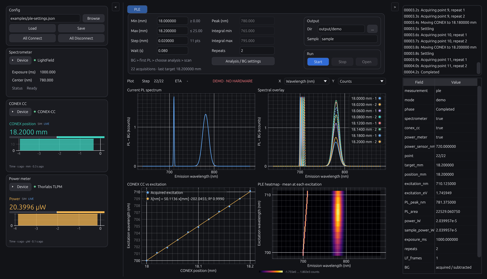

# User guide / 操作ガイド

LightField・CONEX CC・Thorlabsパワーメーターを使う、Rust製PLE測定アプリです。
TRKRと同じ `eframe/egui` / `egui_plot` 系のネイティブGUIを使用します。

- 左：3機器の接続、CONEX位置とパワーのライブ表示。
- 中央：位置走査、初回PLを見たピーク・積分区間の選択、繰り返し・安定待ち。露光などはDevice内。
- 上段：最新／選択PLスペクトル、スペクトルの重ね合わせ。
- 下段：CONEX位置対励起波長、励起波長対発光波長のHeatmap。
- 右：進捗、ピーク・積分値、保存先、ステータスとログ。
- BG差し引きは常時適用。波長／エネルギー表示、パワー正規化、結果再読込。

**v0.2.1：実機確認に渡すリリース候補です。模擬機器と外部APIを自動検証し、Windows x64用exeをクロスビルドしています。Windows上の起動・SDK接続・実測・停止は測定PCでの確認が必要です。**

[実機確認・合否記録の手順](../hardware-qualification.md) · [検証記録](../validation.md)

v0.2.1ではSDK失敗・タイムアウト時のStop確認、再接続時の旧接続の終了、復帰待ち画面、保存データの照合を強化しています。`Device recovery` が表示された場合は、機器状態を確認して `Retry Stop / verify idle`、必要なら切断・再接続で復帰します。待機中に次の測定や移動は開始しません。

## 起動

作業フォルダーの `dist/KohdaLab PLE.app` は、このMacで起動できるApple silicon版です。Rustの追加インストールなしでDemoを試せます。Windows x64版は `dist/kohdalab-ple-windows-x64.zip` です。展開後の `kohdalab-ple.exe` はRustをインストールせずに起動できます。実機用PythonとメーカーSDKは別途必要です。



[eV表示の画面](../images/ple-demo-energy.png) · [最初のPLの確認画面](../images/ple-review.png)

Rust開発環境を用意し、リポジトリのルートから実行します。

```sh
cargo run --locked --bin kohdalab-ple
```

GUIはDemoモードで起動します。機器への自動接続・移動は行いません。
`Config` の `All Connect`、または各機器の `Device` を開いて `Connect` を押し、中央の `Run > Start` で測定を準備します。`Config` カードの右クリックメニューでDemo／Hardwareを切り替えます。モード切替は全機器の切断後に行います。

機器に触れず、接続から測定終了まで通す操作確認：

```sh
cargo run --locked --bin kohdalab-ple -- --auto-demo
```

## 測定手順

1. ConfigでDemo / Hardwareを選択し、各機器のDeviceを開いて接続先を設定します。分光器ではexperiment、中心波長、グレーティング、露光、合成フレーム数を入力できます。グレーティングは元Pythonの3候補・テンプレート保持・任意の正確なLightField名に対応します。接続後の変更は `Apply / read back` で適用します。
2. 走査開始・終了・刻み（mm）、繰り返し、安定待ち、試料名・保存先を設定します。降順では刻みを負にします。実際の最終点を画面に表示します。
3. `Analysis / BG settings` で励起光ピークの探索範囲とBG方式を設定します。手動方式は遮光・光路復帰を確認して進めます。自動方式はMFFのserial、遮光状態番号・開状態番号を指定します。番号と光路の対応はセットアップごとに確認します。
4. Startで新しいBGを取得し、最初の位置のPLを1回取得します。
5. BG差し引き済みの最初のPLを見て、`Peak (nm)`、`Integral min`、`Integral max` を決めます。スペクトルのクリックでもピークを指定できます。ピーク追跡半幅はAnalysis設定で指定します。
6. `Continue` で解析条件を確定し、残りの取得へ進みます。最初のPLは1点目として使い、再取得しません。選択が不正な場合は同じPLを保持して修正を待ちます。
7. 自動シャッター方式では完了・停止・エラー時に遮光を要求し、確認結果をログへ残します。手動方式では遮光操作をユーザーが行います。

LightField内のBG補正を明示的に無効にし、読戻しで確認します。BGは露光・フレーム合成・中心波長・グレーティングの読戻し値と波長配列が一致する取得へだけ適用します。負の差分も保持します。LightFieldの詳細設定も実機側で確認してください。

表示中のHeatmapまたはCONEX対励起波長プロットをクリックすると、上段左が選択データになります。Plotツールバーの右クリックメニューで `Follow latest acquisition` を選ぶと最新取得へ戻ります。重ね合わせは描画負荷を抑えるため全取得範囲から先頭と最新を含む最大8曲線を表示します。すべての取得データは保存します。

## GUIの共通設計

TRKR（`066f8968`）の固定幅3列・フォーム部品・Windowsフォント設定と、IVと共通のダークパレットを使用しています。左右のパネルは同じ開閉操作を持ち、中央だけがウィンドウ幅に追従します。右側は上にログ、下にField／Value表です。

CONEXはteal、パワーはorangeの表示専用モニターで、22pxの数値・中央ゼロのバー・過去30秒までの塗りつぶしトレンド・更新時刻を表示します。横軸は「何秒前」で、LIVE／STALE／HELD／WAITINGとSIM／MEASUREDを区別します。接続や取得元を切り替えると履歴を分けます。

表示用スペクトルは最大8,192頂点へ極値を残して間引き、描画データをキャッシュします。生データ・ピーク解析・積分・CSVは全ビンを保持します。主グラフの線・グリッド・ズーム操作もTRKRに合わせ、強度のSI接頭辞は表示だけに適用します。Heatmapは強度の大小を読むためInfernoを使い、表示データの最小値から最大値へ対応させます。BG差し引き後の負値も保持します。CONEX対励起波長には位置ごとの平均から求めた線形回帰とR²を小さな凡例に表示します。eV表示でも回帰自体は波長nmで求め、曲線を座標変換します。中央PlotのX／Yでnm／eV・Counts／Counts/Wを選べます。右クリックのReset plot viewは表示範囲だけをリセットします。

共通化元とライセンスは [第三者表記](../../third_party/NOTICE.md) に記録しています。

## 実機の設定

LightField接続とThorlabsパワーメーター接続はWindows上のPythonブリッジを利用します。

```powershell
python -m pip install -r bridge/requirements.txt
```

- LightField：`LIGHTFIELD_ROOT`、experiment名、分光器中心波長を設定。gratingが空ならテンプレートの値を保持します。既存の手動起動LightFieldへの接続は実装せず、ブリッジが所有するインスタンスを起動します。
- CONEX：リモートPCのhost / portと、そのPC上のCOMを指定します。Deviceの `Remote JSON` は付属の [CONEXサーバー](../../bridge/README.md) に対応し、移動中の位置読取りと別接続からのStopを使います。旧zipのサーバーには `Legacy TCP` を選びます。既定の接続確認はGETのみで、CHECKによる初期化は明示的に有効化した場合に限ります。旧サーバーは移動中の監視とStopを扱えません。
- パワーメーター：VISA resourceと、元zipから展開した `ThorlabsPowerMeter.py` のあるフォルダーを指定します。`Thorlabs_DotNet_dll`と公式DLLはその配下に置きます。DLLは本アプリへ再配布しません。
- センサー波長は固定、または位置・励起波長の事前校正に追従できます。Powerの詳細設定で選び、Analysisで校正点を入力します。追従時は露光前に波長設定と読戻し・パワー読取りを行い、取得スペクトルから検出した励起波長との許容差も確認します。読戻したセンサー波長・パワー・時刻、光路係数を掛けた試料上推定パワーを別々に保存します。校正点は実測値を使用し、校正範囲外への外挿は行いません。
- CONEXの可動範囲は0–25 mmです。DeviceのSoft min / maxでこの範囲内に制限を狭められます。接続後、DeviceのGo to (mm)へ絶対位置を入力してMoveで手動移動できます。測定中・別の手動移動中は操作をロックし、Stopは有効です。分光器・パワーメーターの接続は手動移動に不要です。

詳細は [ブリッジ仕様](../../bridge/README.md) と [測定・保存仕様](../measurement.md)。

## Python / Jupyterからの外部操作

IV/TRKRと同じく、GUIが機器接続を所有するローカルTCP APIを追加しました。既定では無効で、`--gui-api --config experiment.json` で有効にします。Pythonクライアントは `bindings/python` にあります。

```sh
python -m pip install ./bindings/python
```

`GuiPLE` は状態参照、排他的lease、接続・切断、0–25 mmの手動移動、測定開始、BG・信号確認、最初のPL取得後の解析選択、接続中の分光器設定適用・読戻し、結果のID別待機、Stop完了待ちに対応します。操作中の設定変更はキューへ貯めず拒否し、同じ要求IDの再送で二重測定しません。GUI側のStopとTake controlも残します。

[外部APIの仕様と使用例](../gui-api.md) · [IV/TRKRとの比較・設計監査](../design-audit.md)

## 保存形式

```text
sample_<run-id>/
  settings.json               # 実行時設定、確定した走査点、処理方針
  accepted_settings.json      # 最初のPLで確定した解析条件を含む設定
  analysis.json               # ピーク追跡・積分区間、確定時刻
  status.json                 # 完了／中断／失敗と保存済み取得数
  status.previous.json        # 直前の状態（更新時に保持）
  events.jsonl                # 移動・取得・保存・終了の履歴
  points.csv                  # 位置・励起波長・パワー・PL指標
  raw/
    background.spe            # 実機のLightField生データ
    background.lightfield.csv # LightFieldの元エクスポート
    background.csv            # 波長・生countsの共通形式
    Y_18.6mm_40uW_p00000_r000.spe
    Y_18.6mm_40uW_p00000_r000.lightfield.csv
    Y_18.6mm_40uW_p00000_r000.csv
  processed/
    Y_18.6mm_40uW_p00000_r000.csv # BG・補正後・パワー正規化、nm/eV列
  metadata/
    background.json
    preview.json              # 解析確定前でも最初のPLを保持
    Y_18.6mm_40uW_p00000_r000.json
```

ファイル名の位置は実際の読戻し値、パワーは取得直前の測定値にSample factorを掛けた試料上推定値です。表示用に丸め、point/repeat番号で同名衝突を防ぎます。JSONには丸め前の値と時刻を保持します。

Demoでは実際のSPEを生成せず、CSV・JSONに模擬データを記録します。模擬ファイルをSPEと偽って出力しません。

`Config` のLoad／Saveで設定JSONを読み書きし、Browseでファイルを選べます。`Run > Open`で保存済み測定フォルダーを開けます。過去データを表示する場合は機器を切断してください。

## 停止

RunのStopで以後の取得を止め、LightFieldへ中止を要求します。Remote JSON方式は進行中のCONEX移動にも別接続から停止を要求し、ready状態を確認します。旧TCP方式は移動の完了／タイムアウト待ちになり、位置の古い読み値にはSTALEを表示します。自動シャッター方式は終了時に遮光を要求します。原点復帰は行いません。

ウィンドウを閉じる場合も進行中の操作・保存の終了を待ちます。通信断・タイムアウト時は取得や移動を自動再送しません。Remote Stopの応答を確認できない場合は、遅れて届く停止要求が次の移動に干渉しないよう再接続・移動を禁止します。リモートサービスと実機の状態を確認してサービスを再起動してから、アプリを開き直してください。

## 開発と検証

この作業環境（macOS / Apple silicon）でRust・Pythonの自動テスト、厳格なClippy、波長／eVのGUI模擬測定を確認しました。実機・Windowsでの動作確認とは別です。

```sh
cargo test --workspace --locked
cargo clippy --workspace --all-targets --locked -- -D warnings
python3 -m unittest discover -s tests -v
```

```text
crates/ple-core/       設定・計画・BG差し引き・解析・保存
crates/ple-desktop/    GUI・測定調整・機器アクター・プロセス通信
bridge/               WindowsベンダーSDKとの接続
examples/             設定例
scripts/              ビルド・配布補助
```

本実装はPLEを対象にしています。zip内の偏光回転台、XYマップ、撮影・光路切替、ELN連携などはまだ移植していません。これらの将来拡張に向け、測定計画・解析と機器通信を分離しています。
